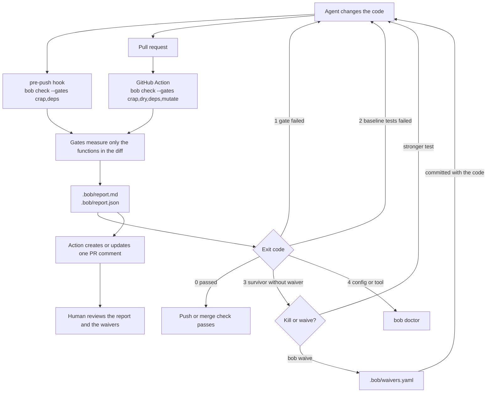

# bob

English | [Português](README.pt-BR.md)

bob gives coding agents (Cursor, Claude Code, GitHub Copilot, Devin) deterministic quality gates for the code they change, plus skills that tell the agent when to run them. The gates measure CRAP, duplication, mutation, and dependencies, only for the functions in the diff. Each run exits with a code the agent can act on and writes a one-page report that tells the human reviewer where to look first. The gates follow Uncle Bob's workflow, and the spec skills come from Matt Pocock (see [Credits](#credits)).

- CLI: `bob` (`bob check | crap | dry | deps | mutate | waive | doctor`)
- PyPI package: `bob-quality` (sdist and wheel ready, not published yet)
- Marketplace name: `bob` (not published yet)
- Configuration: `bob.yaml`
- Reports: `.bob/report.md` and `.bob/report.json` (schema v1)

License: MIT.

## Status

These parts work on `main`:

- CRAP for Python and TypeScript.
- Duplication with jscpd, as a warning only.
- The dependency gate, with the rule that forbids cycles.
- Differential mutation testing for Python, and `bob waive`.
- The GitHub Action that comments the report on the pull request.
- `bob doctor`, and the `bob-quality` package ready to distribute. Nothing has been sent to PyPI.
- Plugin manifests for Claude Code, Cursor, Copilot, and Devin, and the skill installer ([#10](https://github.com/fazedordecodigo/bob/issues/10)). Nothing has been sent to a marketplace.

These parts are planned:

- Mutation testing for TypeScript with StrykerJS ([#8](https://github.com/fazedordecodigo/bob/issues/8)).
- A warning for `no_coverage` mutants in the report ([#31](https://github.com/fazedordecodigo/bob/issues/31)).
- The `bob report` command that `docs/SPEC.md` lists. The CLI does not have it yet.
- Publication on PyPI and on the agent marketplaces.

## Flow

The agent changes the code. The pre-push hook runs the fast gates on the developer's machine, and the GitHub Action runs all four gates on the pull request. Both measure only the functions in the diff, write the same report, and exit with the same codes.



## Installation (development)

```bash
pip install -e ".[dev]"
npm ci
```

These commands install the `bob` command, the Python tools pinned in `pyproject.toml` (`lizard`, `coverage`, `mutmut`, `import-linter`), and the npm tools pinned in `package.json` (`c8`, `vitest`, `jscpd`, `dependency-cruiser`). `bob doctor` shows the expected and the found version of each tool.

## Installing in the agents

Nothing is published. The commands start from a clone of this repository. The plugin ships 30 skills: `bob-check`, `harden`, `review-report`, and Matt Pocock's `engineering/` and `productivity/` skills. That is the same selection as Pocock's own plugin, without `misc/` and `in-progress/`.

**Claude Code** reads `.claude-plugin/`. Add the clone as a local marketplace and install the plugin:

```bash
claude plugin marketplace add <clone path>
claude plugin install bob@bob
```

For a single session, run `claude --plugin-dir <clone path>`.

**Cursor** reads `.cursor-plugin/`. Copy the clone to `~/.cursor/plugins/local/bob` as a real copy, not a symlink, then run **Developer: Reload Window**:

```bash
git clone <clone path> ~/.cursor/plugins/local/bob
```

**GitHub Copilot CLI** also reads `.claude-plugin/`:

```bash
copilot plugin marketplace add <clone path>
copilot plugin install bob@bob
```

**Repository skills.** `install_skills.py` copies the skills, flattened, into a project's skills folder:

```bash
python3 <clone path>/src/bob_quality/install_skills.py --project <project> agents
```

| Target | Folder | Read by |
|---|---|---|
| `agents` | `.agents/skills` | Cursor, Copilot, Devin |
| `devin` | `.agents/skills` | Devin (its recommended folder) |
| `copilot` | `.github/skills` | Copilot, Devin |

Devin reads both folders. If one project gets `copilot` and `devin`, Devin loads every skill twice, so pick one. Running the installer again replaces bob's skills and leaves other skills in the folder alone. Because the installer flattens the folders, each installed skill carries its `LICENSE`, plus `NOTICE` for Pocock's skills. It also runs as `python -m bob_quality.install_skills`. A pip-installed `bob-quality` does not carry the skills, so pass `--source <clone path>`. Without a manifest the installer names the path it read and exits with `4`.

## Usage

In a Python repository with `bob.yaml` and pytest:

```bash
bob check --base main
bob crap --base main
bob dry --base main
bob deps --base main
bob mutate --base main
bob waive <mutant-id|function> --reason "texto de uma linha"
bob doctor
```

Each command accepts these flags:

| Command | Flags |
|---|---|
| `bob check` | `--base`, `--config`, `--out` (default `.bob/`), `--gates` (default `crap,dry,deps`), `--format` (`md`, `json`, or `both`, default `both`) |
| `bob crap` | `--base`, `--config`, `--out`, `--threshold`, `--coverage-file` |
| `bob dry` | `--base`, `--config`, `--out` |
| `bob deps` | `--base`, `--config`, `--out` |
| `bob mutate` | `--base`, `--config`, `--out`, `--max-workers`, `--since-last-run` (reuses the cache, which is already the default) |
| `bob waive` | the mutant id or function name, `--reason` |
| `bob doctor` | `--install` |

The commands write `.bob/report.md` and `.bob/report.json`. The exit codes are:

| Code | Meaning |
|---|---|
| `0` | Every gate that ran passed. |
| `1` | A gate failed. A changed function has CRAP at or above the limit, or the diff has a dependency violation. |
| `2` | The baseline tests failed before bob could measure. |
| `3` | A surviving mutant has no waiver. |
| `4` | Configuration error or missing tool. |

When more than one gate fails, `bob check` exits with the highest code.

A local `bob check` does not run mutation. `bob check --gates mutate` and `bob mutate` run it, only on the changed functions and on the functions that still have survivors.

## How it works

### Only the diff blocks

bob runs `git diff <base>...HEAD` and maps the changed lines to functions. A function counts as changed when the diff touches one of its lines. Only changed functions, and dependency violations that touch changed files, can fail a gate. Old debt goes to the informational sections of the report, marked `fora do diff; não bloqueia`, and does not change the exit code. `--base` overrides the `base` key in `bob.yaml`.

### Pinned tools per language

bob wraps each tool in its own adapter and copies no code from them. The versions are pinned in `pyproject.toml` and `package.json`.

| Gate | Python | TypeScript |
|---|---|---|
| CRAP | `lizard` 1.24.1 for complexity, `coverage` 7.16.2 running pytest | `lizard` 1.24.1 for complexity, `c8` 12.0.0 running `vitest` 5.0.3 |
| Duplication | `jscpd` 5.4.1 | `jscpd` 5.4.1 |
| Mutation | `mutmut` 3.8.0 | planned ([#8](https://github.com/fazedordecodigo/bob/issues/8)) |
| Dependencies | `import-linter` 2.15 | `dependency-cruiser` 18.5.0 |

The npm tools need Node, and jscpd needs it in a Python-only repository too. In a repository with Python and TypeScript, a missing Node is not exit `4`. bob still measures Python and reports TypeScript as skipped, with a warning. Exit `4` stays when the missing tool blocks the requested measurement, as in a TypeScript-only repository without Node.

### `bob.yaml`

bob reads these keys. The values below are the defaults that apply when `bob.yaml` does not exist:

```yaml
base: origin/main
languages: [python]
paths:
  include: [src]
  exclude: [tests, node_modules, dist]
crap:
  max_per_function: 10
  scope: changed
duplication:
  min_tokens: 50
dependencies:
  python: .importlinter
  typescript: .dependency-cruiser.cjs
```

With `crap.scope: changed`, only changed functions block. Any other value makes every measured function count. If `--config` points to a file that does not exist, or the YAML is not a mapping, the run exits with `4`.

### `bob doctor` and `--install`

`bob doctor` lists each tool with the pinned and the found version. It exits with `0` when all match, and with `4` when a tool is missing or differs, together with the install command. If the package directory is not writable, the message asks for `bob doctor --install`.

`bob doctor --install` runs `npm ci` in the installed package. When the package directory is not writable, it installs into a user cache (`$XDG_CACHE_HOME/bob-quality`, or `~/.cache/bob-quality`). Then it prints the same report.

### Waivers

Waivers live in `.bob/waivers.yaml`, which you commit with the code. `bob waive` writes one entry with these fields:

- `id`, the mutant id or the function name.
- `reason`, one line of text.
- `author`, from `git config user.name`, or `$USER`.
- `date`, the UTC date.

A waiver without a one-line reason is rejected with exit `4`. A new waiver with the same `id` replaces the old one. A waiver matches a mutant by the mutant id, the function name, `file:function`, or `file::function`. An invalid `waivers.yaml` makes the run exit with `4`. The agent writes the waiver, and the human approves it in the pull request review. Every waiver appears at the top of the report.

### The report

`.bob/report.md` is one page for the reviewer. `.bob/report.json` has the same data and follows the schema in `src/bob_quality/schemas/report_v1.json` (`schema_version: 1`). `--format` picks one file or both. The Markdown report has these parts, with the headings in Portuguese:

1. `Waivers`, when there are waivers or mutation ran.
2. A header with the commit, the base, the date, and the tool versions.
3. `Veredito`, one line per gate: ✅ passed, ⚠️ warning, ❌ failed, or ⏭️ not run with the reason. A gate that did not run never shows as ✅.
4. `Onde focar o review`, the changed files ordered by risk (highest CRAP, plus clones and survivors).
5. `Top 5 funções por CRAP (diff)`.
6. `Informação (dívida antiga)`, functions outside the diff at or above the limit.
7. `Violações e ciclos de dependência`, and `Informação (dependências fora do diff)`.
8. `Clones novos`.
9. `Mutantes sobreviventes`.
10. `Como reproduzir`, the exact command to run locally.

## Concepts

### CRAP

CRAP combines the complexity of a function with how much of it the tests run. A complex function with few tests is where a change is most likely to break something nobody sees, so the reviewer looks there first.

```text
CRAP = CC² × (1 − cov)³ + CC
```

`CC` is the cyclomatic complexity from lizard. `cov` is the fraction of the function's executable lines that the tests ran, from coverage.py or c8. A function with no executable lines counts as fully covered.

| CC | Coverage | CRAP | Result |
|---|---|---|---|
| 4 | 50% | 16 × 0.125 + 4 = 6 | passes |
| 5 | 0% | 25 × 1 + 5 = 30 | fails |
| 10 | 100% | 0 + 10 = 10 | fails |

The limit is CRAP < 10 per changed function. A function with CRAP of 10 or more fails the gate with exit `1`. Because CRAP is never below CC, a changed function with CC 10 or more fails at the default limit even with full coverage. Change the limit with `crap.max_per_function` in `bob.yaml` or with `bob crap --threshold`.

### Duplication (DRY)

A clone is a block of code that repeats another block. New clones show where the agent copied code instead of reusing it.

bob runs jscpd and keeps only the clones where at least one side touches a changed line. For example, if the diff adds a block of at least 50 tokens that matches existing code, the report lists the pair under `Clones novos` and the verdict shows ⚠️. The exit code stays `0`.

The limit is `duplication.min_tokens` (default 50). Duplication is a warning only and never changes the exit code. Without Node, the gate shows as ⏭️.

### Mutation testing

Coverage shows that a line ran. It does not show that a test checks the result. Mutation testing makes a small change to the code, called a mutant, and runs the tests again. If a test fails, the mutant is killed. If every test still passes, the mutant survived, and that line is not really tested.

- `killed`, `survived`, `timeout`, and `no_coverage` are the mutant states. `no_coverage` means no test ran the mutant.
- An equivalent mutant changes the code without changing its behavior, so no test can kill it. bob has no separate state for it. Record a waiver instead, as the `harden` skill describes.
- A waiver is a one-line reason, approved by the human in review, for a survivor that should not be killed.

For example, a mutant changes `if total > limit:` to `if total >= limit:`. If no test uses `total == limit`, the mutant survives. Write that test, or run `bob waive` with a reason.

bob mutates Python with mutmut. It runs the baseline tests first and exits with `2` if they fail. It mutates the changed functions, plus the functions that still have survivors without a waiver. The cache `.bob/mutation-cache.json` stores a hash of each function's text, so bob reuses the results of functions that did not change. The GitHub Action restores and publishes the cache as the `bob-mutation-cache` artifact.

The limit is zero survivors without a waiver. Any such survivor fails the gate with exit `3`. The report lists only survivors. Mutants with `killed`, `timeout`, and `no_coverage` do not block. A warning for `no_coverage` mutants is planned ([#31](https://github.com/fazedordecodigo/bob/issues/31)), and so is TypeScript mutation ([#8](https://github.com/fazedordecodigo/bob/issues/8)).

### Dependencies

Dependency rules and cycles show architecture erosion. When module A imports B and B imports A, neither can change alone.

bob runs the rules the repository already declares, in `.importlinter` for Python (import-linter) and in `.dependency-cruiser.cjs` for TypeScript (dependency-cruiser). It adds one rule that is always on, `Proibido ciclo de dependência`, which forbids dependency cycles. For example, if `app.a` imports `app.b` and the diff makes `app.b` import `app.a`, the gate shows ❌ and exits with `1`.

The limit is zero violations in the diff. A violation blocks only when its origin, its destination, or another module in the same cycle (strongly connected component) changed in the diff. Older violations appear as `fora do diff; não bloqueia`.

## Pre-push hook

The script `src/bob_quality/hooks/pre-push` runs `bob check --gates crap,deps`, the fast gates. `tests/test_hook.py` checks that it finishes in under 60 s on the fixture.

```bash
cp src/bob_quality/hooks/pre-push .git/hooks/pre-push
chmod +x .git/hooks/pre-push
```

## Tests

```bash
pytest
```

The repository fixtures are in `tests/fixtures`: `python_app` (a passing case and a case that fails with CRAP > 10), `ts_app`, and `mixed_app`. `tests/fixtures/raw` has recorded output from the pinned tools.

The CI (`.github/workflows/ci.yml`) runs this suite on Python 3.10 and 3.12, on pull requests and on pushes to `main`.

## GitHub Action

The composite action in `.github/actions/bob` installs `bob` and runs `bob check` with `crap,dry,deps,mutate`. It restores and publishes the `bob-mutation-cache` artifact (`.bob/mutation-cache.json`), and it creates or updates a single pull request comment with `.bob/report.md`. The job exit code is the one from `bob`.

The action accepts the inputs `base`, `gates`, `pip-spec`, and `token`. This repository uses it in `.github/workflows/bob.yml`. `bob-quality` is not on PyPI yet, so in a checkout of this repository the action runs `pip install -e ".[dev]"`, and in another repository it installs the action's git source. Publication on the GitHub Marketplace is not part of this slice.

## Skills

- Matt Pocock's spec flow (MIT, attributed), in `skills/vendor/mattpocock/`: `grill-me` → `to-spec` → `to-tickets` → `implement-spec` / `tdd` → `code-review`.
- `skills/bob-check/` says when and how to run `bob check`.
- `skills/harden/` says how to kill a surviving mutant or record a waiver.
- `skills/review-report/` summarizes `.bob/report.md` in the pull request.
- `AGENTS.md` is the index for agents.
- `.claude-plugin/` and `.cursor-plugin/` are the plugin manifests. See [Installing in the agents](#installing-in-the-agents).

## Credits

The gates follow Uncle Bob's workflow. The READMEs and the output of his tools [crapper](https://github.com/unclebob/crapper) and [mutator](https://github.com/unclebob/mutator) (0BSD) are the behavior reference, and bob reuses none of their code. The exit codes take after mutator. The duplication gate uses jscpd. A structural dryer of bob's own, in the line of his [dryer](https://github.com/unclebob/dryer) (0BSD), is out of scope for the MVP. The limits come from his recent posts, CRAP < 10 for agents ([post on X](https://x.com/unclebobmartin/status/2108946115169030596)) and kill mutants within reason ([Aviator podcast](https://www.aviator.co/podcast/uncle-bob-martin-ai-clean-code)).

The spec skills are a verbatim copy of [mattpocock/skills](https://github.com/mattpocock/skills) at commit `49dd158d1076134a641b33efb035946536778336`, under the MIT license. See `skills/vendor/mattpocock/LICENSE` and `skills/vendor/mattpocock/NOTICE`.

The market tools (lizard, coverage.py, c8, vitest, mutmut, jscpd, import-linter, dependency-cruiser) are pinned dependencies, and bob copies no code from them.

## License

MIT. See `LICENSE`.
