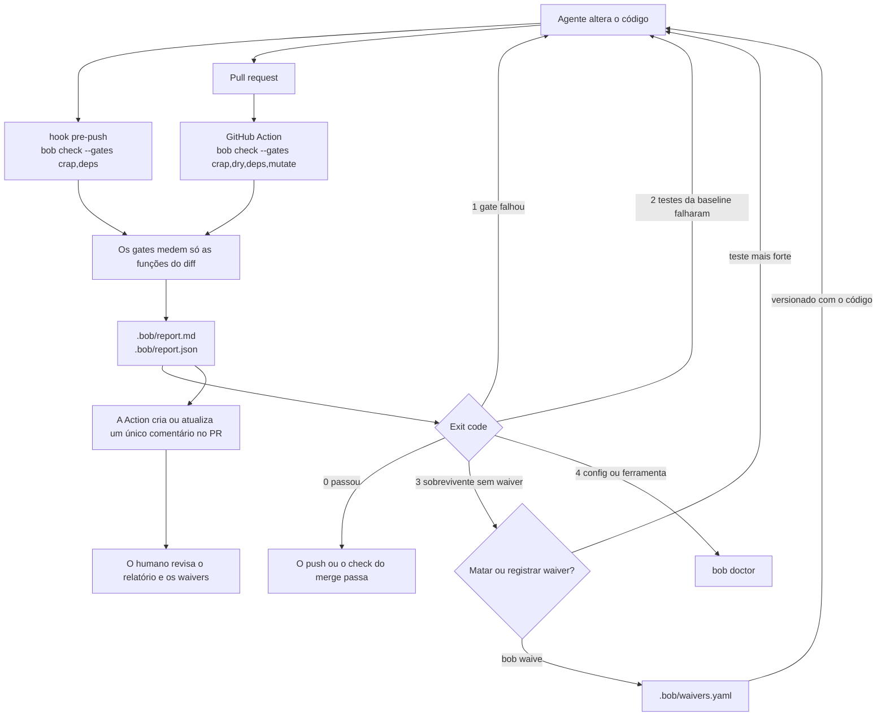

# bob

[English](README.md) | Português

O bob dá aos agentes de código (Cursor, Claude Code, GitHub Copilot, Devin) gates de qualidade determinísticos para o código que eles alteram, mais skills que dizem ao agente quando rodá-los. Os gates medem CRAP, duplicação, mutação e dependências, só nas funções do diff. Cada execução sai com um código que o agente consegue usar e grava um relatório de uma página que diz ao revisor humano onde olhar primeiro. Os gates seguem o fluxo do Uncle Bob, e as skills de spec vêm do Matt Pocock (ver [Créditos](#créditos)).

- CLI: `bob` (`bob check | crap | dry | deps | mutate | waive | doctor`)
- Pacote PyPI: `bob-quality` (sdist e wheel prontos, ainda não publicado)
- Nome nos marketplaces: `bob` (ainda não publicado)
- Configuração: `bob.yaml`
- Relatórios: `.bob/report.md` e `.bob/report.json` (schema v1)

Licença: MIT.

## Status

Estas partes funcionam na `main`:

- CRAP em Python e TypeScript.
- Duplicação com jscpd, só como aviso.
- O gate de dependências, com a regra que proíbe ciclos.
- Mutação diferencial em Python, e `bob waive`.
- A GitHub Action que comenta o relatório no pull request.
- `bob doctor`, e o pacote `bob-quality` pronto para distribuir. Nada foi enviado ao PyPI.
- Os manifestos de plugin para Claude Code, Cursor, Copilot e Devin, e o instalador de skills ([#10](https://github.com/fazedordecodigo/bob/issues/10)). Nada foi enviado a marketplace.

Estas partes estão planejadas (planned):

- Mutação em TypeScript com StrykerJS ([#8](https://github.com/fazedordecodigo/bob/issues/8)).
- Um aviso para mutantes `no_coverage` no relatório ([#31](https://github.com/fazedordecodigo/bob/issues/31)).
- O comando `bob report` que o `docs/SPEC.md` lista. A CLI ainda não o tem.
- Publicação no PyPI e nos marketplaces dos agentes.

## Fluxo

O agente altera o código. O hook pre-push roda os gates rápidos na máquina de quem desenvolve, e a GitHub Action roda os quatro gates no pull request. Os dois medem só as funções do diff, gravam o mesmo relatório e saem com os mesmos códigos.



## Instalação (desenvolvimento)

```bash
pip install -e ".[dev]"
npm ci
```

Esses comandos instalam o comando `bob`, as ferramentas Python pinadas em `pyproject.toml` (`lizard`, `coverage`, `mutmut`, `import-linter`) e as ferramentas npm pinadas em `package.json` (`c8`, `vitest`, `jscpd`, `dependency-cruiser`). `bob doctor` mostra a versão esperada e a encontrada de cada ferramenta.

## Instalação nos agentes

Nada foi publicado. Os comandos partem de um clone deste repositório. O plugin traz 30 skills: `bob-check`, `harden`, `review-report` e as skills de `engineering/` e `productivity/` do Matt Pocock. É a mesma seleção do plugin do próprio Pocock, sem `misc/` nem `in-progress/`.

**Claude Code** lê `.claude-plugin/`. Adicione o clone como marketplace local e instale o plugin:

```bash
claude plugin marketplace add <caminho do clone>
claude plugin install bob@bob
```

Para uma sessão só, rode `claude --plugin-dir <caminho do clone>`.

**Cursor** lê `.cursor-plugin/`. Copie o clone para `~/.cursor/plugins/local/bob` como cópia real, não como symlink, e rode **Developer: Reload Window**:

```bash
git clone <caminho do clone> ~/.cursor/plugins/local/bob
```

**GitHub Copilot CLI** também lê `.claude-plugin/`:

```bash
copilot plugin marketplace add <caminho do clone>
copilot plugin install bob@bob
```

**Skills do repositório.** O `install_skills.py` copia as skills, achatadas, para a pasta de skills de um projeto:

```bash
python3 <caminho do clone>/src/bob_quality/install_skills.py --project <projeto> agents
```

| Alvo | Pasta | Lida por |
|---|---|---|
| `agents` | `.agents/skills` | Cursor, Copilot, Devin |
| `devin` | `.agents/skills` | Devin (a pasta recomendada por ele) |
| `copilot` | `.github/skills` | Copilot, Devin |

O Devin lê as duas pastas. Se um projeto receber `copilot` e `devin`, o Devin carrega cada skill duas vezes, então escolha um. Rodar o instalador de novo substitui as skills do bob e não mexe nas outras skills da pasta. Como o instalador achata as pastas, cada skill instalada leva o seu `LICENSE`, e as do Pocock levam também o `NOTICE`. Ele também roda como `python -m bob_quality.install_skills`. O `bob-quality` instalado pelo pip não traz as skills, então passe `--source <caminho do clone>`. Sem manifesto, o instalador diz o caminho que leu e sai com `4`. Quando uma skill não tem `LICENSE` da pasta dela até a raiz do plugin, o instalador avisa no stderr e ainda assim a instala.

## Uso

Num repositório Python com `bob.yaml` e pytest:

```bash
bob check --base main
bob crap --base main
bob dry --base main
bob deps --base main
bob mutate --base main
bob waive <mutant-id|function> --reason "texto de uma linha"
bob doctor
```

Cada comando aceita estas flags:

| Comando | Flags |
|---|---|
| `bob check` | `--base`, `--config`, `--out` (padrão `.bob/`), `--gates` (padrão `crap,dry,deps`), `--format` (`md`, `json` ou `both`, padrão `both`) |
| `bob crap` | `--base`, `--config`, `--out`, `--threshold`, `--coverage-file` |
| `bob dry` | `--base`, `--config`, `--out` |
| `bob deps` | `--base`, `--config`, `--out` |
| `bob mutate` | `--base`, `--config`, `--out`, `--max-workers`, `--since-last-run` (reusa o cache, que já é o padrão) |
| `bob waive` | o id do mutante ou o nome da função, `--reason` |
| `bob doctor` | `--install` |

Os comandos gravam `.bob/report.md` e `.bob/report.json`. Os exit codes são:

| Código | Significado |
|---|---|
| `0` | Todo gate que rodou passou. |
| `1` | Um gate falhou. Uma função alterada tem CRAP no limite ou acima, ou o diff tem uma violação de dependência. |
| `2` | Os testes da baseline falharam antes de o bob medir. |
| `3` | Um mutante sobrevivente não tem waiver. |
| `4` | Erro de configuração ou ferramenta ausente. |

Quando mais de um gate falha, `bob check` sai com o código mais alto.

`bob check` local não roda mutação. `bob check --gates mutate` e `bob mutate` rodam, só nas funções alteradas e nas funções que ainda têm sobreviventes.

## Como funciona

### Só o diff bloqueia

O bob roda `git diff <base>...HEAD` e mapeia as linhas alteradas para funções. Uma função conta como alterada quando o diff toca uma das linhas dela. Só funções alteradas, e violações de dependência que tocam arquivos alterados, podem reprovar um gate. A dívida antiga vai para as seções informativas do relatório, marcada `fora do diff; não bloqueia`, e não muda o exit code. `--base` substitui a chave `base` do `bob.yaml`.

### Ferramentas pinadas por linguagem

O bob encapsula cada ferramenta num adaptador próprio e não copia código delas. As versões estão pinadas em `pyproject.toml` e `package.json`.

| Gate | Python | TypeScript |
|---|---|---|
| CRAP | `lizard` 1.24.1 para complexidade, `coverage` 7.16.2 rodando o pytest | `lizard` 1.24.1 para complexidade, `c8` 12.0.0 rodando o `vitest` 5.0.3 |
| Duplicação | `jscpd` 5.4.1 | `jscpd` 5.4.1 |
| Mutação | `mutmut` 3.8.0 | planejada ([#8](https://github.com/fazedordecodigo/bob/issues/8)) |
| Dependências | `import-linter` 2.15 | `dependency-cruiser` 18.5.0 |

As ferramentas npm precisam do Node, e o jscpd precisa dele também num repositório só Python. Num repositório com Python e TypeScript, a falta do Node não é exit `4`. O bob continua medindo o Python e mostra o TypeScript como pulado, com aviso. O exit `4` continua quando a ferramenta ausente impede a medição pedida, como num repositório só TypeScript sem Node.

### `bob.yaml`

O bob lê estas chaves. Os valores abaixo são os padrões que valem quando o `bob.yaml` não existe:

```yaml
base: origin/main
languages: [python]
paths:
  include: [src]
  exclude: [tests, node_modules, dist]
crap:
  max_per_function: 10
  scope: changed
duplication:
  min_tokens: 50
dependencies:
  python: .importlinter
  typescript: .dependency-cruiser.cjs
```

Com `crap.scope: changed`, só funções alteradas bloqueiam. Qualquer outro valor faz toda função medida contar. Se `--config` aponta para um arquivo que não existe, ou se o YAML não é um mapeamento, a execução sai com `4`.

### `bob doctor` e `--install`

`bob doctor` lista cada ferramenta com a versão pinada e a encontrada. Sai com `0` quando todas coincidem, e com `4` quando alguma falta ou diverge, junto com o comando de instalação. Se o diretório do pacote não for gravável, a mensagem pede `bob doctor --install`.

`bob doctor --install` roda `npm ci` no pacote instalado. Quando o diretório do pacote não é gravável, instala num cache do usuário (`$XDG_CACHE_HOME/bob-quality`, ou `~/.cache/bob-quality`). Depois imprime o mesmo relatório.

### Waivers

Os waivers ficam em `.bob/waivers.yaml`, versionado junto com o código. `bob waive` grava uma entrada com estes campos:

- `id`, o id do mutante ou o nome da função.
- `reason`, uma linha de texto.
- `author`, de `git config user.name`, ou `$USER`.
- `date`, a data em UTC.

Um waiver sem motivo de uma linha é rejeitado com exit `4`. Um waiver novo com o mesmo `id` substitui o antigo. Um waiver casa com um mutante pelo id do mutante, pelo nome da função, por `file:function` ou por `file::function`. Um `waivers.yaml` inválido faz a execução sair com `4`. O agente grava o waiver, e o humano o aprova no review do pull request. Todo waiver aparece no topo do relatório.

### O relatório

`.bob/report.md` é uma página para quem revisa. `.bob/report.json` tem os mesmos dados e segue o schema em `src/bob_quality/schemas/report_v1.json` (`schema_version: 1`). `--format` escolhe um arquivo ou os dois. O relatório em Markdown tem estas partes, com os títulos em português:

1. `Waivers`, quando há waivers ou a mutação rodou.
2. Um cabeçalho com o commit, a base, a data e as versões das ferramentas.
3. `Veredito`, uma linha por gate: ✅ passou, ⚠️ aviso, ❌ falhou ou ⏭️ não executado com o motivo. Um gate que não rodou nunca aparece como ✅.
4. `Onde focar o review`, os arquivos alterados ordenados por risco (maior CRAP, mais clones e sobreviventes).
5. `Top 5 funções por CRAP (diff)`.
6. `Informação (dívida antiga)`, funções fora do diff no limite ou acima.
7. `Violações e ciclos de dependência`, e `Informação (dependências fora do diff)`.
8. `Clones novos`.
9. `Mutantes sobreviventes`.
10. `Como reproduzir`, o comando exato para rodar localmente.

## Conceitos

### CRAP

O CRAP combina a complexidade de uma função com o quanto dela os testes executam. Uma função complexa e pouco testada é onde uma mudança tem mais chance de quebrar algo que ninguém vê, então o revisor olha ali primeiro.

```text
CRAP = CC² × (1 − cov)³ + CC
```

`CC` é a complexidade ciclomática medida pelo lizard. `cov` é a fração das linhas executáveis da função que os testes executaram, medida pelo coverage.py ou pelo c8. Uma função sem linhas executáveis conta como totalmente coberta.

| CC | Cobertura | CRAP | Resultado |
|---|---|---|---|
| 4 | 50% | 16 × 0.125 + 4 = 6 | passa |
| 5 | 0% | 25 × 1 + 5 = 30 | falha |
| 10 | 100% | 0 + 10 = 10 | falha |

O limite é CRAP < 10 por função alterada. Uma função com CRAP 10 ou mais reprova o gate com exit `1`. Como o CRAP nunca fica abaixo do CC, uma função alterada com CC 10 ou mais falha no limite padrão mesmo com cobertura total. Mude o limite com `crap.max_per_function` no `bob.yaml` ou com `bob crap --threshold`.

### Duplicação (DRY)

Um clone é um bloco de código que repete outro bloco. Clones novos mostram onde o agente copiou código em vez de reusar.

O bob roda o jscpd e fica só com os clones em que pelo menos um dos lados toca uma linha alterada. Por exemplo, se o diff adiciona um bloco de pelo menos 50 tokens igual a um código que já existe, o relatório lista o par em `Clones novos` e o veredito mostra ⚠️. O exit code continua `0`.

O limite é `duplication.min_tokens` (padrão 50). Duplicação é só aviso e nunca muda o exit code. Sem Node, o gate aparece como ⏭️.

### Teste de mutação

A cobertura mostra que uma linha rodou. Ela não mostra que um teste confere o resultado. O teste de mutação faz uma pequena mudança no código, chamada mutante, e roda os testes de novo. Se um teste falha, o mutante morreu. Se todos os testes continuam passando, o mutante sobreviveu, e aquela linha não está testada de verdade.

- `killed`, `survived`, `timeout` e `no_coverage` são os estados de um mutante. `no_coverage` quer dizer que nenhum teste executou o mutante.
- Um mutante equivalente muda o código sem mudar o comportamento, então nenhum teste consegue matá-lo. O bob não tem um estado separado para ele. Registre um waiver, como a skill `harden` descreve.
- Um waiver é um motivo de uma linha, aprovado pelo humano no review, para um sobrevivente que não deve ser morto.

Por exemplo, um mutante troca `if total > limit:` por `if total >= limit:`. Se nenhum teste usa `total == limit`, o mutante sobrevive. Escreva esse teste, ou rode `bob waive` com um motivo.

O bob muta Python com o mutmut. Ele roda os testes da baseline primeiro e sai com `2` se eles falham. Ele muta as funções alteradas, mais as funções que ainda têm sobreviventes sem waiver. O cache `.bob/mutation-cache.json` guarda um hash do texto de cada função, então o bob reusa o resultado das funções que não mudaram. A GitHub Action restaura e publica o cache como o artefato `bob-mutation-cache`.

O limite é zero sobreviventes sem waiver. Qualquer sobrevivente assim reprova o gate com exit `3`. O relatório lista só os sobreviventes. Mutantes `killed`, `timeout` e `no_coverage` não bloqueiam. Um aviso para mutantes `no_coverage` está planejado ([#31](https://github.com/fazedordecodigo/bob/issues/31)), assim como a mutação em TypeScript ([#8](https://github.com/fazedordecodigo/bob/issues/8)).

### Dependências

Regras de dependência e ciclos mostram erosão de arquitetura. Quando o módulo A importa B e B importa A, nenhum dos dois muda sozinho.

O bob roda as regras que o repositório já declara, em `.importlinter` para Python (import-linter) e em `.dependency-cruiser.cjs` para TypeScript (dependency-cruiser). Ele soma uma regra sempre ativa, `Proibido ciclo de dependência`, que proíbe ciclos de dependência. Por exemplo, se `app.a` importa `app.b` e o diff faz `app.b` importar `app.a`, o gate mostra ❌ e sai com `1`.

O limite é zero violações no diff. Uma violação só bloqueia quando a origem, o destino ou outro módulo do mesmo ciclo (componente fortemente conexo) foi alterado no diff. Violações antigas aparecem como `fora do diff; não bloqueia`.

## Hook pre-push

O script `src/bob_quality/hooks/pre-push` roda `bob check --gates crap,deps`, os gates rápidos. `tests/test_hook.py` confere que ele termina em menos de 60 s no fixture.

```bash
cp src/bob_quality/hooks/pre-push .git/hooks/pre-push
chmod +x .git/hooks/pre-push
```

## Testes

```bash
pytest
```

Os repositórios-fixture estão em `tests/fixtures`: `python_app` (um caso que passa e um caso que falha por CRAP > 10), `ts_app` e `mixed_app`. `tests/fixtures/raw` tem saídas gravadas das ferramentas pinadas.

O CI (`.github/workflows/ci.yml`) roda essa suíte em Python 3.10 e 3.12, em pull requests e em pushes para `main`.

## GitHub Action

A action composta em `.github/actions/bob` instala o `bob` e roda `bob check` com `crap,dry,deps,mutate`. Ela restaura e publica o artefato `bob-mutation-cache` (`.bob/mutation-cache.json`) e cria ou atualiza um único comentário no pull request com `.bob/report.md`. O exit code do job é o do `bob`.

A action aceita os inputs `base`, `gates`, `pip-spec` e `token`. Este repositório a usa em `.github/workflows/bob.yml`. O `bob-quality` ainda não está no PyPI, então no checkout deste repositório a action roda `pip install -e ".[dev]"`, e em outro repositório instala o código-fonte git da action. Publicação no GitHub Marketplace não faz parte desta fatia.

## Skills

- O fluxo de spec do Matt Pocock (MIT, atribuído), em `skills/vendor/mattpocock/`: `grill-me` → `to-spec` → `to-tickets` → `implement-spec` / `tdd` → `code-review`.
- `skills/bob-check/` diz quando e como rodar `bob check`.
- `skills/harden/` diz como matar um mutante sobrevivente ou registrar um waiver.
- `skills/review-report/` resume `.bob/report.md` no pull request.
- `AGENTS.md` é o índice para agentes.
- `.claude-plugin/` e `.cursor-plugin/` são os manifestos do plugin. Veja [Instalação nos agentes](#instalação-nos-agentes).

## Créditos

Os gates seguem o fluxo do Uncle Bob. Os READMEs e as saídas das ferramentas dele [crapper](https://github.com/unclebob/crapper) e [mutator](https://github.com/unclebob/mutator) (0BSD) são a referência de comportamento, e o bob não reusa código delas. Os exit codes se inspiram no mutator. O gate de duplicação usa o jscpd. Um dryer estrutural próprio do bob, na linha do [dryer](https://github.com/unclebob/dryer) (0BSD) dele, fica fora do escopo do MVP. Os limites vêm dos posts recentes dele, CRAP < 10 para agentes ([post no X](https://x.com/unclebobmartin/status/2108946115169030596)) e matar mutantes dentro do razoável ([podcast da Aviator](https://www.aviator.co/podcast/uncle-bob-martin-ai-clean-code)).

As skills de spec são uma cópia literal de [mattpocock/skills](https://github.com/mattpocock/skills) no commit `49dd158d1076134a641b33efb035946536778336`, sob a licença MIT. Ver `skills/vendor/mattpocock/LICENSE` e `skills/vendor/mattpocock/NOTICE`.

As ferramentas de mercado (lizard, coverage.py, c8, vitest, mutmut, jscpd, import-linter, dependency-cruiser) são dependências pinadas, e o bob não copia código delas.

## Licença

MIT. Ver `LICENSE`.
