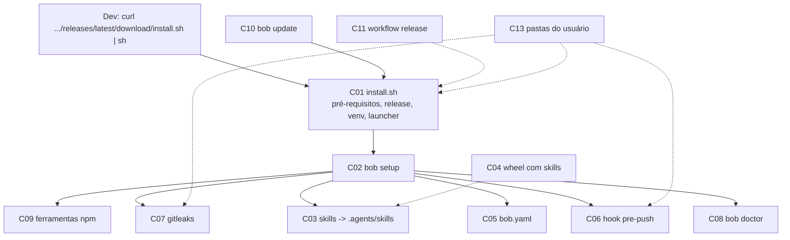

# 2.6 Application Design — Componentes

Projeto: bob. Profundidade: Minimal. Autor: Arquiteto Técnico. Data: 2026-10-18 (UTC-3).
Base do código: `fazedordecodigo/bob`, `main` @ `d2e26bd` (2026-10-18 16:39 UTC-3). Leitura remota, sem clone.
Insumos: intent, 2.1 (`inception/reverse-engineering/`), `requirements.md` (34 FR, 9 NFR), `stories.md` (13 US).
Decisões: `decisions.md` (ADR 0008 a 0020). Interfaces: `component-interfaces.md`.

## Visão em uma frase
O dev roda um comando (`install.sh` da última release). Ele confere Python e Node, instala o pacote numa pasta do usuário e chama `bob setup` no projeto. O `bob setup` instala ferramentas npm e gitleaks, copia as skills para `.agents/skills`, cria `bob.yaml`, ativa o hook e roda o `bob doctor`.



## Catálogo

| Id | Nome | Tipo | Responsabilidade | ADR |
|---|---|---|---|---|
| C01 | Bootstrap `install.sh` | novo | Conferir SO, arquitetura, Python e Node. Resolver a release (última publicada ou `BOB_VERSION`). Baixar e conferir wheel. Criar venv da versão. Trocar o `current`. Ligar o launcher. Chamar `bob setup`. | 0011, 0012, 0013 |
| C02 | `bob setup` | novo | Orquestrar os passos no projeto, na ordem fixa. Preservar e avisar. Imprimir o resumo. Sair com o código do doctor. | 0012, 0017 |
| C03 | Instalador de skills | alterado | Usa o alvo `agents` que já existe (`.agents/skills`). Fonte padrão: o pacote instalado. Marcador de posse. Escrita só quando o conteúdo muda. | 0009, 0010, 0017 |
| C04 | Empacotamento do wheel | alterado | Levar `skills/`, `.claude-plugin/plugin.json` e `LICENSE` dentro do pacote. | 0010 |
| C05 | Gerador de `bob.yaml` | novo | Criar `bob.yaml` com os padrões do README e `paths.include` derivado. Validar com `load_config` antes de gravar. | 0015, 0017 |
| C06 | Instalador do hook | novo | Escrever o hook gerenciado com o caminho absoluto do launcher. Preservar hook alheio e `core.hooksPath`. | 0016, 0017 |
| C07 | Instalador do gitleaks | novo | Tabela das 4 plataformas. Baixar, conferir sha256, extrair e instalar na pasta do bob. | 0014 |
| C08 | `bob doctor` | alterado | Versões npm e faixa do Node lidas do `package.json` empacotado. Não olhar `node_modules` do projeto. Achar gitleaks na pasta do bob. `--install` instala npm e gitleaks. | 0008, 0014, 0019 |
| C09 | Fonte das versões npm | alterado | Ler `dependencies` e `engines.node` do `package.json` empacotado. Teste de paridade com o lock. | 0008 |
| C10 | `bob update` e `bob --version` | novo | Consultar a última release publicada. Comparar versões. Rodar o `install.sh` da release nova. Mostrar versão do pacote e das skills do projeto. | 0018 |
| C11 | Workflow `release` | novo | Build do wheel, `SHA256SUMS`, `twine check`, `bob doctor`, verificação de instalação, e anexar `install.sh`, wheel e `SHA256SUMS` à release. Disparo manual pelo Emerson. | 0011 |
| C12 | Docs de instalação | alterado | Comando único como caminho principal. Requisitos e versões certos. Atualizar e ver versão. Teste de paridade de versões. | 0020 |
| C13 | Pastas do usuário | novo | Calcular `BOB_HOME` e subpastas (`versions/`, `current`, `bin/`, `tools/`). Sem `sudo`. | 0013 |

## Detalhe por componente

### C01 — Bootstrap `install.sh` (novo, `scripts/install.sh`)
- Shell POSIX (`/bin/sh`). Linux e macOS, x64 e arm64 (R-S1). Sem `sudo` (NFR7).
- Não toca o projeto. Se falha antes do passo final, 0 arquivos do projeto mudam (US1.2 crit. 3).
- Fonte da versão: `BOB_VERSION` (tag) ou `GET /repos/fazedordecodigo/bob/releases/latest` (só release publicada; ADR 0011).
- Confere o wheel com `SHA256SUMS` da mesma release (`sha256sum` ou `shasum -a 256`).
- Instala em `BOB_HOME/versions/<versão>/venv`. Reusa se já existe e confere.
- Se `~/.local/bin` não está no `PATH`, acrescenta uma linha marcada (`# managed-by: bob-quality`) ao perfil do shell de `$SHELL`, uma vez só (ADR 0013, Q1 A).
- Termina com `exec env BOB_INSTALL_PROFILE=<resultado> "$BOB_HOME/bin/bob" setup`.
- As faixas de Python e Node ficam no script. Um teste garante paridade com `pyproject.toml` e `package.json` (ADR 0008).

### C02 — `bob setup` (novo, `src/bob_quality/setup_cmd.py`)
- Passos, nesta ordem: 1 projeto git; 2 Python e Node; 3 ferramentas npm (C09); 4 gitleaks (C07); 5 skills (C03); 6 `bob.yaml` (C05); 7 hook (C06); 8 `bob doctor` (C08); 9 resumo.
- Para no primeiro passo que falha. Cita o passo e a ação (FR7.2, NFR9). Sai `4`.
- Não pergunta nada (R-S3). Idempotente (NFR4).
- Não altera manifestos nem lockfiles do projeto (FR2.4). Escreve só em `.agents/skills/<skill do bob>/`, `bob.yaml` (se ausente) e no hook (se ausente ou do bob).

### C03 — Instalador de skills (alterado, `src/bob_quality/install_skills.py`)
- Sem alvo novo. Alvos `copilot` (`.github/skills`), `devin` e `agents` (os dois em `.agents/skills`) ficam como estão (`install_skills.py:17-21`).
- `bob setup` usa só `agents` (ADR 0009).
- `--source` padrão: o clone, se `parents[2]` tem manifesto; senão a pasta empacotada `bob_quality/plugin/` (ADR 0010).
- Grava `.bob-version` em cada pasta de skill instalada. É o marcador de posse e a versão das skills (ADR 0017, 0018).
- Pasta existente sem `.bob-version`: fica, com aviso (FR3.4).
- Pasta com `.bob-version` e nome fora do manifesto novo: removida (skill aposentada pelo bob).
- Grava só quando o conteúdo difere (NFR4).
- Detecta cópias antigas do bob em `.agents/skills` e `.github/skills` e avisa que o agente pode ver duplicata. Não apaga.

### C04 — Empacotamento do wheel (alterado, `pyproject.toml` e `src/bob_quality/plugin/`)
- Nova pasta `src/bob_quality/plugin/` com symlinks: `.claude-plugin` → `../../../.claude-plugin`, `skills` → `../../../skills`, `LICENSE` → `../../../LICENSE`.
- Mesmo padrão já usado em `src/bob_quality/package.json` (symlink no git; o build copia o arquivo, visto no log do run 39159800688).
- `package-data` ganha `plugin/.claude-plugin/plugin.json`, `plugin/skills/**/*`, `plugin/LICENSE`.
- Teste novo abre o wheel e confere as três `SKILL.md`, o manifesto e o `LICENSE`.

### C05 — Gerador de `bob.yaml` (novo, `src/bob_quality/init_config.py`)
- Regra de `paths.include`: ADR 0015.
- Gera texto fixo com as chaves do README (`README.pt-BR.md:182-203`), sem a chave `languages` (o padrão do README é detectar).
- Valida com `load_config` num arquivo temporário. Só então grava, por rename atômico.
- Já existe `bob.yaml`: não lê para alterar, não escreve, avisa (FR4.6).

### C06 — Instalador do hook (novo, `src/bob_quality/hook_install.py`; template alterado em `src/bob_quality/hooks/pre-push`)
- Destino: `git rev-parse --git-path hooks` + `/pre-push` (funciona em worktree).
- Template com marcador `# managed-by: bob-quality` e caminho absoluto de `BOB_HOME/bin/bob`.
- Hook existente sem marcador: preservado, com aviso (FR5.3).
- `core.hooksPath` definido: não escreve, avisa com a linha a acrescentar (ADR 0016).

### C07 — Instalador do gitleaks (novo, `src/bob_quality/gitleaks.py`)
- Tabela única de versão, assets e sha256 (ADR 0014). O doctor importa dela.
- Baixa para pasta temporária, confere sha256, extrai só o membro `gitleaks`, move para `BOB_HOME/tools/gitleaks/8.30.1/gitleaks`, liga `BOB_HOME/bin/gitleaks`.
- Falha de conferência: apaga o temporário, não instala, sai `4` (FR2.3, NFR6).
- Já instalado e com `gitleaks version` = 8.30.1: não baixa de novo.

### C08 — `bob doctor` (alterado, `src/bob_quality/doctor.py`)
- `NpmPin` perde o campo `expected`. A versão vem de C09.
- Procura npm só no prefixo do bob (`npm_prefix()`), não em `Path.cwd()/node_modules` (`doctor.py:358-360` sai) (FR2.5).
- Binários: primeiro `BOB_HOME/bin`, depois `PATH`.
- `--install`: npm (como hoje) e gitleaks (C07).
- Linha informativa nova: versão das skills em `.agents/skills` do projeto atual. Não muda o código de saída.

### C09 — Fonte das versões npm (alterado, `src/bob_quality/npm_tools.py`)
- Função nova `pinned_npm_versions()` lê `dependencies` do `package.json` do prefixo do plugin. Exige spec `x.y.z`.
- Função nova `node_range()` lê `engines.node` e aceita só a forma `>=A.B.C <N`.
- `tests/test_npm_pin.py` perde a cópia fixa (`:20-31`) e passa a conferir lock = `package.json`.

### C10 — `bob update` e `bob --version` (novo, `src/bob_quality/update.py`; `cli.py` alterado)
- `bob update`: consulta a última release publicada, compara com a versão instalada (tupla numérica de `vX.Y.Z`).
- Igual ou mais velha: avisa, não altera nada, sai `0` (FR6.5).
- Mais nova: baixa `install.sh` e `SHA256SUMS` dessa tag, confere, roda com `BOB_VERSION=<tag>` na pasta do projeto.
- `bob --version`: versão do pacote e versão das skills do projeto (`.bob-version`).

### C11 — Workflow `release` (novo, `.github/workflows/release.yml`)
- `workflow_dispatch` com a tag. Disparo é do Emerson (P2).
- Passos: build, `twine check --strict`, `bob doctor`, `scripts/verify-install.sh` com `BOB_RELEASES_URL` local, criar release com `install.sh`, wheel e `SHA256SUMS`.

### C12 — Docs (alterado)
- `README.md`, `README.pt-BR.md`, `docs/instalacao.md`, `docs/getting-started/installation.md`, `docs/getting-started/agents.md`, `docs/guides/pre-push.md`.
- Teste novo `tests/test_docs_pins.py`: toda versão citada nos docs bate com `pyproject.toml` e `package.json` (ADR 0020).

### C13 — Pastas do usuário (novo, `src/bob_quality/user_dirs.py` e o mesmo cálculo em `install.sh`)
- `BOB_HOME` = `$BOB_HOME` ou `${XDG_DATA_HOME:-$HOME/.local/share}/bob-quality`.
- `versions/<v>/venv`, `current` → `versions/<v>`, `bin/bob` → `current/venv/bin/bob`, `bin/gitleaks`, `tools/`.
- Launcher do usuário: `~/.local/bin/bob` → `BOB_HOME/bin/bob` (PATH: linha marcada no perfil do shell, feita pelo C01; regra na ADR 0013, Q1 A).

## Bloco yaml
```yaml
components:
  - id: C01
    nome: bootstrap install.sh
    responsabilidade: conferir pré-requisitos, resolver release, instalar pacote na pasta do usuário e chamar bob setup
    depende_de: [C13, C11]
    arquivos: [scripts/install.sh]
  - id: C02
    nome: bob setup
    responsabilidade: orquestrar a configuração do projeto, preservar e avisar, resumo e código de saída
    depende_de: [C03, C05, C06, C07, C08, C09]
    arquivos: [src/bob_quality/setup_cmd.py, src/bob_quality/cli.py, src/bob_quality/messages.py]
  - id: C03
    nome: instalador de skills
    responsabilidade: copiar as skills do pacote para .agents/skills com marcador de posse, idempotente
    depende_de: [C04]
    arquivos: [src/bob_quality/install_skills.py]
  - id: C04
    nome: empacotamento do wheel
    responsabilidade: levar skills, manifesto e LICENSE no wheel
    depende_de: []
    arquivos: [pyproject.toml, src/bob_quality/plugin/.claude-plugin, src/bob_quality/plugin/skills, src/bob_quality/plugin/LICENSE, tests/test_packaging.py]
  - id: C05
    nome: gerador de bob.yaml
    responsabilidade: criar bob.yaml com padrões do README e paths.include derivado, validado por load_config
    depende_de: []
    arquivos: [src/bob_quality/init_config.py, src/bob_quality/config.py]
  - id: C06
    nome: instalador do hook
    responsabilidade: escrever hook gerenciado com caminho absoluto, preservar hook alheio e core.hooksPath
    depende_de: [C13]
    arquivos: [src/bob_quality/hook_install.py, src/bob_quality/hooks/pre-push]
  - id: C07
    nome: instalador do gitleaks
    responsabilidade: baixar, conferir sha256 e instalar gitleaks 8.30.1 por plataforma
    depende_de: [C13]
    arquivos: [src/bob_quality/gitleaks.py]
  - id: C08
    nome: bob doctor
    responsabilidade: conferir só as ferramentas do bob, com versões de fonte única
    depende_de: [C07, C09, C13]
    arquivos: [src/bob_quality/doctor.py]
  - id: C09
    nome: fonte das versões npm
    responsabilidade: ler versões npm e faixa do Node do package.json empacotado; paridade com o lock
    depende_de: []
    arquivos: [src/bob_quality/npm_tools.py, package.json, package-lock.json, tests/test_npm_pin.py]
  - id: C10
    nome: bob update e bob --version
    responsabilidade: atualizar para a última release publicada e mostrar versões
    depende_de: [C01, C03]
    arquivos: [src/bob_quality/update.py, src/bob_quality/cli.py]
  - id: C11
    nome: workflow release
    responsabilidade: gerar e anexar install.sh, wheel e SHA256SUMS à release, depois de verificar
    depende_de: [C01, C04]
    arquivos: [.github/workflows/release.yml, scripts/verify-install.sh]
  - id: C12
    nome: docs de instalação
    responsabilidade: comando único, requisitos e versões certos, atualizar e ver versão
    depende_de: [C09]
    arquivos: [README.md, README.pt-BR.md, docs/instalacao.md, docs/getting-started/installation.md, docs/getting-started/agents.md, docs/guides/pre-push.md, tests/test_docs_pins.py]
  - id: C13
    nome: pastas do usuário
    responsabilidade: calcular BOB_HOME e subpastas, sem sudo
    depende_de: []
    arquivos: [src/bob_quality/user_dirs.py, scripts/install.sh]
```
