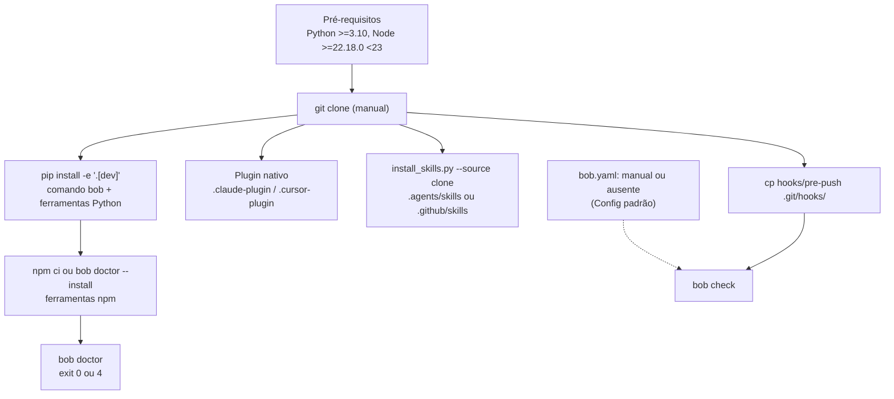

# 2.1 Reverse Engineering — Arquitetura (instalação e configuração)

Repo: `fazedordecodigo/bob`, branch `main`, commit `d2e26bd` (2026-10-18 16:39 UTC-3).
Profundidade: Minimal. Escopo: só o que toca instalação e configuração.
Evidência no formato `arquivo:linha`, no commit acima. Leitura remota, sem clone.

## Visão geral
- Há dois artefatos. O pacote pip `bob-quality` entrega o comando `bob`. O plugin `bob` entrega as skills (`docs/instalacao.md:5`).
- Nada está publicado no PyPI nem em marketplace (`README.pt-BR.md:8-9`, `docs/instalacao.md:5`).
- O caminho documentado parte de um clone (`docs/instalacao.md:5`, `docs/getting-started/installation.md:5`).
- São quatro passos manuais separados: pacote, ferramentas npm, skills e hook. Não há comando que una os quatro.

## Fluxo de instalação de ponta a ponta (hoje)
1. Pré-requisitos: Python `>=3.10` (`pyproject.toml:10`) e Node `>=22.18.0 <23` (`package.json:6`, `src/bob_quality/doctor.py:62`).
2. Pacote: `python3 -m venv .venv`, `pip install -e '.[dev]'` dentro do clone (`README.pt-BR.md:64-68`). Instala o script `bob` (`pyproject.toml:36-37`) e as ferramentas Python pinadas (`pyproject.toml:13-25`).
3. Ferramentas npm: `npm ci` na raiz do clone (`README.pt-BR.md:67`), ou `bob doctor --install`, que roda `npm ci --prefix` no pacote instalado (`src/bob_quality/npm_tools.py:133-142`, `:165-170`). Se o sistema de arquivos negar, vai para `$XDG_CACHE_HOME/bob-quality` ou `~/.cache/bob-quality` (`src/bob_quality/npm_tools.py:145-154`, `:196-199`).
4. Skills, por um de dois caminhos:
   - Plugin nativo, a partir do clone: Claude Code e Copilot CLI por `plugin marketplace add` (`README.pt-BR.md:76-96`); Cursor por cópia em `~/.cursor/plugins/local/bob` (`README.pt-BR.md:85-89`).
   - Cópia para o projeto: `install_skills.py --project <projeto> <alvo>` (`README.pt-BR.md:98-102`). De um pip install, exige `--source <clone>` (`README.pt-BR.md:110`).
5. `bob.yaml`: não há gerador. Sem `bob.yaml`, a CLI usa os padrões da classe `Config` e detecta linguagens (`src/bob_quality/config.py:311-316`).
6. Hook pre-push: cópia manual com `cp` e `chmod +x` (`README.pt-BR.md:321-324`).
7. Verificação: `bob doctor` compara cada ferramenta pinada com a encontrada e sai `0` ou `4` (`src/bob_quality/doctor.py:123-139`, `:175-178`).

## Caminho sem clone que já existe (só no CI)
- A GitHub Action, fora do repo do bob, instala `bob-quality[dev] @ git+https://github.com/<repo>.git@<ref>` (`.github/actions/bob/resolve_install.py:36-40`, `.github/actions/bob/install.sh:12-17`).
- Isso indica que o pacote já instala direto do GitHub, sem clone manual. Não testei fora do CI (Não verificado).
- A Action não instala skills (`docs/adr/0004-empacotamento-quatro-agentes.md:37`). Nenhum passo dela instala o hook (`.github/actions/bob/action.yml:38-105`).
- Esse caminho não está documentado para o dev local. Não achei `git+` em `README.pt-BR.md`, `docs/instalacao.md` nem `docs/getting-started/installation.md`.

## Diagrama

## Pontos de arquitetura relevantes para o intent
- O instalador de skills não é subcomando de `bob` (`docs/adr/0004-empacotamento-quatro-agentes.md:23`). Roda só com stdlib (`src/bob_quality/install_skills.py:1-4`).
- A fonte única da lista de skills é `.claude-plugin/plugin.json` (`docs/adr/0004-empacotamento-quatro-agentes.md:19`, `src/bob_quality/install_skills.py:24`, `:117-118`).
- O instalador procura o manifesto em `PLUGIN_ROOT = parents[2]` do próprio arquivo (`src/bob_quality/install_skills.py:23`). Num clone, é a raiz. Num pacote instalado, não há manifesto ali, por isso o `--source` (`docs/adr/0004-empacotamento-quatro-agentes.md:31`).
- O wheel leva `package.json`, `package-lock.json`, `js/`, `hooks/*` e `schemas/*.json` (`pyproject.toml:42-43`). Não leva `skills/` nem `.claude-plugin/`.
- As versões npm aparecem em dois lugares: `package.json` e a tupla `PINS` do doctor (`package.json:8-18`, `src/bob_quality/doctor.py:64-112`). Hoje divergem no vitest (ver `technology-stack.md`).
