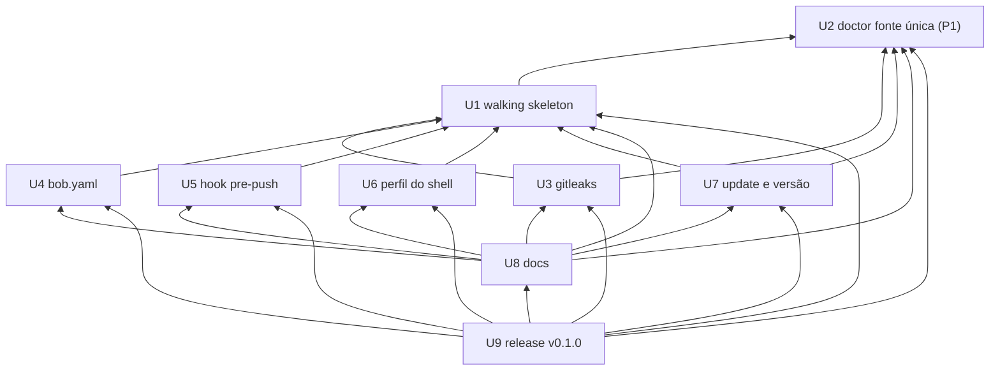

# 2.7 Units — Dependências (DAG)

Só dependências. Ordem de entrega e prioridade: Maestro, no 2.9.
"A → B" = A depende de B (B precisa existir para A ficar pronto).



```yaml
U1: [U2]
U2: []
U3: [U1, U2]
U4: [U1]
U5: [U1]
U6: [U1]
U7: [U1, U2]
U8: [U1, U2, U3, U4, U5, U6, U7]
U9: [U1, U2, U3, U4, U5, U6, U7, U8]
```

## Justificativa das arestas
| Aresta | Por quê |
|---|---|
| U1 → U2 | O pronto do U1 é `bob doctor: 0`. Na `main`, o doctor sai `4` (vitest `5.0.4` em `doctor.py:70` × `5.0.5` em `package.json:15`). Sem a P1, o skeleton não fecha. |
| U3 → U1 | O passo `gitleaks` entra no registro de passos do `bob setup` (C02) e grava em `BOB_HOME` (C13), donos no U1. |
| U3 → U2 | Estende o C08: gitleaks em `BOB_HOME/bin` e `--install` com gitleaks. |
| U4 → U1 | O passo `bob.yaml` entra no `bob setup` (C02) e o resumo dele (preservado, sem código). |
| U5 → U1 | O passo `hook` entra no `bob setup` (C02); o hook usa o caminho fixo `BOB_HOME/bin/bob` (C13). |
| U6 → U1 | Estende o `install.sh` (C01) e o resumo do `bob setup` (C02). |
| U7 → U1 | `bob update` roda o `install.sh` (C01) com `BOB_VERSION`; lê `.bob-version` (C03); usa o formato de release fixado no U1. |
| U7 → U2 | Estende o C08 (linha "skills do projeto"). |
| U8 → U1–U7 | Os docs descrevem o comportamento final de cada unit (comando, gitleaks, `bob.yaml`, hook, PATH, update). O teste de paridade lê a fonte única do U2. |
| U9 → U1–U8 | A release roda o `verify-install.sh` completo (passos de U1 a U7) e sai com os docs certos (U8). |

## Sem ciclos
- Ordem topológica válida: U2, U1, U3, U4, U5, U6, U7, U8, U9 (só prova de ausência de ciclo; não é ordem de entrega).
- Conferido por script (Kahn) sobre o bloco yaml: 9 nós visitados, 0 restantes.
- U4, U5, U6 e U7 não dependem entre si.
