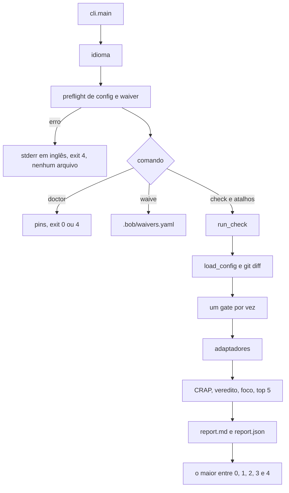

# Avaliação de arquitetura do bob

Data da leitura: 12/10/2026. Base: `246d2eb` em `main`.

O bob é a CLI do pacote PyPI `bob-quality` e o plugin de marketplace `bob`. Ele mede um diff com CRAP, duplicação, dependências e mutação, e devolve um relatório de uma página mais um exit code. Cursor, Claude Code, Copilot e Devin recebem as skills `bob-check`, `harden` e `review-report`.

Três trabalhos em andamento ficam de fora das recomendações novas. A issue #53 valida `bob.yaml` e `waivers.yaml` além do que o PR #51 já rejeita. O pull request #55 fecha a issue #54 no instalador. A issue #8 é a mutação TypeScript com Stryker.

As ADRs desta pasta registram decisões que a spec ou um PR já tomou, e que a página de pesquisa ou o código ainda contradizem.

- [0001](0001-adaptadores-sobre-ferramentas-de-mercado.md) fixa ferramentas de mercado atrás de adaptadores.
- [0002](0002-o-diff-filtra-o-veredito.md) separa medição da árvore e bloqueio pelo diff.
- [0003](0003-exit-codes.md) fixa os cinco exit codes e as exceções já aprovadas.
- [0004](0004-empacotamento-quatro-agentes.md) fixa os quatro agentes e a lista única de skills.

## Visão geral

O desenho tem quatro costuras, como a spec descreve.

1. `cli.py` resolve o idioma e faz o preflight. `check`, `crap`, `dry`, `deps` e `mutate` viram `run_check`. `doctor` e `waive` saem desse caminho depois do mesmo preflight.
2. Os gates disparam as ferramentas pinadas. Os adaptadores só parseiam texto ou JSON para o modelo.
3. `crap.py`, `core.py` e `probe.py` não importam adaptador. Juntam complexidade ciclomática e cobertura de linha, aplicam a fórmula e marcam o que o diff pode bloquear.
4. `check.py` monta o `Report`. `report.py` grava `.bob/report.md` e `.bob/report.json` com `schema_version` 1. O exit do processo é o maior código entre os gates.

A medição não é só o diff. Lizard, coverage.py, c8, jscpd, import-linter e dependency-cruiser veem `paths.include`. O diff escolhe quais funções, clones e arestas entram no veredito.

Mutação não entra num `bob check` sem flags. `DEFAULT_GATES` é `crap`, `dry`, `deps`. Não há detector de CI dentro da CLI.

## Conceitos

**Diff.** `changed_lines` guarda o lado novo do patch. Um hunk novo de comprimento zero ainda registra a linha de início. `function_is_changed` é sobreposição inclusiva de `[start, end]`.

**CRAP.** Uma linha editada cobra a função inteira. A fórmula é `CC² × (1 − cov)³ + CC`. `cov` é a fração de statements no intervalo da função. O limite padrão é 10, e o bloqueio é maior ou igual. O campo `delta` existe e sai vazio. No Markdown a célula fica em branco.

**DRY.** jscpd na árvore de include, com `min_tokens` padrão 50. Clone que cruza o diff vira aviso. Exit do gate continua 0.

**Dependências.** Bloqueia aresta ligada a um arquivo alterado, ou a outro módulo do mesmo componente fortemente conexo em Python. A regra de ciclo entra sempre. `dependencies.violation` não é lido.

**Mutação.** Cache em `{out}/mutation-cache.json`. A chave da corrida é a versão do mutmut e o sha256 da suíte. Por função, a chave interna é `arquivo::nome`.

**Exit.** 0 passou, 1 limite, 2 baseline, 3 sobrevivente sem waiver, 4 config ou ferramenta. Aviso também sai 0.

**Idioma.** A primeira fonte definida vence. `--lang`, depois `BOB_LANG`, depois `language` no `bob.yaml`, depois `en`. O JSON fica em inglês. O Markdown traduz e acrescenta `--lang` no comando de reprodução. O título `## Waivers` permanece em inglês.

## Como funciona

`bob.yaml` é lido até três vezes no `check`. Idioma, preflight, `load_config`. Sem arquivo, vale o padrão. Base `origin/main`, linguagens `["python"]`, include `src`, CRAP 10, escopo `changed`, `min_tokens` 50. Não há autodetecção. `languages` omitido ou lista vazia vira `["python"]`.

`crap.scope` só filtra o veredito. A string exata `changed` olha funções tocadas. Qualquer outra string não vazia conta toda função medida.

Cada gate devolve um status e um inteiro. O status vai para o relatório. O inteiro entra em `_worse`.

O foco de um arquivo é o maior CRAP entre as funções alteradas dele. Clone marca `clone: true` e não soma número. Cada sobrevivente sem waiver soma 100.

Waivers ficam em `.bob/waivers.yaml`. O casamento usa o id do mutante, o nome nu da função, `arquivo:função` e `arquivo::função`. O primeiro item da lista cujo id está nesse conjunto ganha. Nome nu casa em todo arquivo.

`--since-last-run` entra só na string de reprodução. Reusar o cache já é o padrão.

A ordem do Markdown é waivers, cabeçalho, veredito, foco, top 5, dívida antiga, dependências, clones, sobreviventes, `no_coverage`, reproduzir. A decisão 5 manda os waivers no topo. A lista numerada da spec põe os clones antes das dependências.

## Onde fica

| Peça | Caminho |
| --- | --- |
| Roteador | `src/bob_quality/cli.py` |
| Orquestração e `DEFAULT_GATES` | `src/bob_quality/check.py` |
| Config que o YAML realmente lê | `src/bob_quality/config.py` |
| Exit codes | `src/bob_quality/exit_codes.py` |
| Diff | `src/bob_quality/diff.py` |
| Fórmula e veredito | `src/bob_quality/crap.py`, `src/bob_quality/core.py` |
| Adaptadores | `src/bob_quality/adapters/` |
| Cache e waivers | `src/bob_quality/mutate.py`, `src/bob_quality/waivers.py` |
| Relatório | `src/bob_quality/report.py` |
| Hook | `src/bob_quality/hooks/pre-push` |
| Action | `.github/actions/bob/` |
| Manifesto fonte | `.claude-plugin/plugin.json` |
| Skills | `skills/bob-check`, `skills/harden`, `skills/review-report` |

Pins pip em `pyproject.toml`: lizard 1.24.1, coverage.py 7.16.2, import-linter 2.15, grimp 3.17, mutmut 3.8.0. Pins npm, iguais na raiz e em `src/bob_quality/package.json`: c8 12.0.0, dependency-cruiser 18.5.0, jscpd 5.4.1, vitest 5.0.3. O `doctor` exige Node 22.14.0 exato. A issue #42 pede uma faixa.

## Armadilhas

**Quatro lugares escolhem gates diferentes.**

| Lugar | Gates |
| --- | --- |
| `bob check` sem `--gates` | `crap`, `dry`, `deps` |
| Spec, e a skill ao falar do hook | `crap`, `dry`, `deps` |
| Hook real e a seção de hook do README | `crap`, `deps` |
| Skill ao falar do CI como `bob check` nu | inclui `mutate` |
| Action, e o workflow `bob.yml` sem inputs | `crap`, `dry`, `deps`, `mutate` |
| `ci.yml` | só pytest |

**`bob report` não existe.** A spec, `bob-check` e `review-report` citam o comando. `build_parser` não o registra. O README diz que está planejado. O `check` já grava os dois relatórios.

**Chaves da spec que `Config` não tem.** `mutation.*`, `duplication.tool`, `duplication.new_clones`, `dependencies.violation`. O loader recusa a chave desconhecida com exit `4`. Um agente que escreve `mutation.differential: false` não desliga o cache: o comando sai com `unknown key mutation`.

**Dois formatos do exit 4, e o jscpd fora deles.** O preflight não grava arquivo. Config que escapa do preflight, como `duplication` inválida ou `--config` ausente, grava o relatório. Ferramenta ausente no CRAP, no deps ou na mutação também grava. jscpd ausente ou ilegível fica `not_run` com exit 0.

**Argparse também sai 2.** Falta de subcomando ou flag ilegal termina no status de uso do `ArgumentParser`. A skill manda tratar 2 como baseline quebrada.

**JSON de dependência sem lista de violações vira lista vazia.** `_violation_items` em `dependency_cruiser.py` devolve `[]` quando o objeto não traz `summary.violations` nem `violations`. O gate pode passar.

**Cache inválido esquece sobrevivente fora do diff.** Fechado na issue #63. Se a versão do mutmut ou a impressão da suíte muda, os corpos ficam inelegíveis e o nome do sobrevivente sem waiver permanece. A corrida seguinte remuta essa função.

**Top 5 e a issue #29.** `top_changed_crap` não junta funções pelo nome. Cada métrica guarda o próprio arquivo. O colapso que existe é a chave `arquivo::nome` do cache de mutação, dentro de um arquivo.

**README atrasado no `no_coverage`.** O aviso já existe, e a decisão 11 o descreve. O README ainda diz que está planejado na #31. A #31 está fechada. A fase seguinte é a #41.

## Por que o desenho é este

O motivo do produto está escrito. A spec, linhas 7 a 9, diz que o review virou o gargalo e que regra de qualidade em prosa é ignorada. A [página de pesquisa](https://app.notion.com/p/3f6cc91c731d81c3bcb0d42894f5acc2), de 10/10/2026, diz a mesma coisa. Gates determinísticos com exit code, diff para o custo ficar baixo, relatório de uma página para o humano, supervisão gentil em vez de linha de montagem.

Python, os nomes `bob` e `bob-quality`, duplicação só como aviso, e os cinco exit codes estão na spec como decisão de 10/10/2026. Não há frase que compare Python com outra linguagem, nem CRAP 10 com CRAP 6. A pesquisa ainda deixa as duas alternativas abertas. Os tickets e a spec é que escolhem ferramentas de mercado e o limite 10.

O lizard está na decisão 2 para as duas linguagens contarem a complexidade do mesmo jeito. A troca das skills do Pocock pelo Poteto está na issue #47 como pedido do Emerson em 11/10/2026.

Slack no workspace de ambassadors não tem deliberação do CLI. Não há ADR anterior a esta pasta. O heading de `55216ad` cita `grill-me`. O commit `4f63964` remove a string. O repositório não contém a transcrição.

Confiança. O motivo do produto e as decisões datadas são citação direta da spec, dos PRs #20, #26, #27, #28, #36, #44, #51 e #52, e da página de pesquisa. Por que Python, por que 10 e não 6, por que o hook não tem `dry`, e por que `bob report` segue na spec são lacunas.

## Riscos

1. Um agente que segue `bob-check` ao pé da letra trata `bob check` nu como a corrida de CI, com mutação, e trata exit 2 como teste quebrado. Os dois estão errados em parte dos caminhos. O primeiro porque o padrão da CLI omite `mutate`. O segundo porque o argparse usa o mesmo inteiro.
2. Uma mudança de teste que invalida a impressão da suíte remuta o sobrevivente fora do diff. O gate sai 0 só quando a corrida nova não acha sobrevivente sem waiver.
3. Um JSON do dependency-cruiser com outro formato parece "nenhuma violação". O gate de arquitetura passa calado.
4. A próxima edição de uma função em `cli.py` com CRAP alto bloqueia o PR. A issue #21 já registra CRAP 110 nesse arquivo. O limite do próprio bob é 10 para função alterada.
5. A issue #41 estima centenas de mutantes `no_coverage` se essa fase passar a sair 3. Waiver novo nesse caminho depende de aprovação do Emerson.

## Dívida já rastreada

Estas issues continuam abertas.

| Issue | O que já está pedido |
| --- | --- |
| #8 | Adaptador Stryker e mutação TypeScript incremental |
| #21 | Baixar o CRAP de `cli.py` |
| #24 | Mutar método de classe |
| #25 | Waiver estável, alvo inexistente, limpeza de `mutants/` |
| #29 | Top 5 e funções de mesmo nome. Ver a armadilha acima antes de implementar |
| #34 | `bob doctor --install` num checkout editável cria `src/bob_quality/node_modules` |
| #37 | Lista de divergências entre spec e código, inclusive `bob report` e autodetect |
| #41 | `no_coverage` no diff passa a sair 3 |
| #42 | Node `>=22.14.0 <23` no doctor |
| #45 | Skills dentro do wheel. O texto ainda cita LICENSE do Pocock |
| #48 | Idioma da Action e caixa de `pt-BR` |
| #53 | Validação semântica de config e waiver. Em andamento |
| #54 | `rmtree` em skill que é link. O PR #55 está aberto em cima dela |

## Recomendações

Mudança de spec continua sujeita ao OK do Emerson, como as fatias já dizem.

A prioridade segue o dano para o agente que obedece exit code e skill. P0 mente sobre o resultado ou esconde sobrevivente. P1 frauda um gate ou manda rodar um comando que não existe. P2 é documentação ou pin que um agente pode acertar sem mudar veredito.

Issues desta avaliação: [#61](https://github.com/fazedordecodigo/bob/issues/61), [#62](https://github.com/fazedordecodigo/bob/issues/62), [#63](https://github.com/fazedordecodigo/bob/issues/63), [#64](https://github.com/fazedordecodigo/bob/issues/64), [#65](https://github.com/fazedordecodigo/bob/issues/65), [#66](https://github.com/fazedordecodigo/bob/issues/66), [#67](https://github.com/fazedordecodigo/bob/issues/67), [#68](https://github.com/fazedordecodigo/bob/issues/68), [#69](https://github.com/fazedordecodigo/bob/issues/69).

### P0. Um conjunto de gates por lugar

O hook, o padrão da CLI, a skill e a Action discordam. Um agente não tem como saber qual comando é o local e qual é o CI.

Alvo.

- O hook passa a `bob check --gates crap,dry,deps`, como a spec e a user story 10.
- `bob check` sem `--gates` continua `crap,dry,deps`.
- A skill deixa de dizer que `bob check` nu roda mutação. O CI é o comando da Action, `bob check --gates crap,dry,deps,mutate`.
- A Action não muda o padrão.
- Um teste trava o comando do hook e a frase da skill.

Fora de escopo. Implementar `bob report`. Mexer na #53, na #8 ou no PR #55. Ligar mutação no hook.

Justificativa. A skill é o que o agente obedece. Quatro frases para o mesmo comando fazem o agente ou pular a mutação no CI ou rodá-la no laptop.

### P0. Erro de uso não usa o exit 2

`ArgumentParser` sai 2 quando o subcomando falta ou a flag é ilegal. A skill manda corrigir a baseline.

Alvo. Esse caminho sai 4, com mensagem que não fala em baseline. Um teste cobre `bob` sem subcomando e uma flag ilegal. Exit 2 continua reservado à suíte que falha antes da medida.

Fora de escopo. Redesenhar os outros produtores de 4. A #53.

Justificativa. O inteiro já tem um significado no domínio. O segundo significado vem da biblioteca de argv, não de uma decisão da spec.

### P0. Cache inválido não esquece sobrevivente fora do diff

Quando `mutmut` ou `suite` não batem, os corpos guardados ficam inelegíveis para reuso. Os nomes dos sobreviventes sem waiver permanecem. A corrida remuta as funções alteradas e essas funções. Resultados só `killed`, com waiver ou `no_coverage`, fora do diff, não são copiados adiante.

Alvo. O teste `test_a_new_suite_file_remutates_an_unwaived_survivor_outside_the_diff` monta o cache, planta um sobrevivente fora do diff, muda a impressão da suíte com um arquivo de teste, e exige que essa função seja remutada.

Fora de escopo. Issue #8, #24, #25 e #41. Não mudar o que conta como `survived`. Não fazer `no_coverage` falhar.

Justificativa. O PR #43 diz que a chave é o preço de não esconder sobrevivente. Descartar o mapa inteiro escondia o sobrevivente fora do diff. A leitura guarda o nome e joga o corpo fora.

### P1. JSON do dependency-cruiser sem lista não passa

`parse_dependency_cruiser` devolve `[]` se o JSON é um objeto sem `summary.violations` e sem `violations`. Zero arestas no diff é exit 0.

Alvo. Esse formato sai 4, com o gate `not_run`. `{"summary": {"violations": []}}` continua passagem limpa. Um fixture cobre os dois. O mesmo critério vale se o import-linter sair 0 com texto que não tem aresta e não é um relatório vazio reconhecível. Não alargar isso para o jscpd. O PR #26 já fixou o dry em exit 0.

Fora de escopo. A regra de ciclo. A #53.

Justificativa. O parse é a fronteira. Lista vazia por contrato quebrado é outro evento que lista vazia porque não houve violação.

### P1. Skills não mandam rodar `bob report`

`bob-check` e `review-report` citam um subcomando que `cli.py` não tem.

Alvo. As duas skills apontam para `bob check --format both`, que já grava `.bob/report.md` e `.bob/report.json`. Se o teste de contrato exige o texto da spec com `bob report`, o teste passa a exigir a frase nova. Não implementar o subcomando nesta issue. A #37 continua dona da decisão de criar o comando ou tirá-lo da spec.

Fora de escopo. Criar `bob report`. Traduzir o título `## Waivers`. A #48.

Justificativa. O agente executa a skill. O comando falha antes de qualquer gate.

### P1. Pinar o grimp da regra de ciclo

O componente fortemente conexo vem de um `python -c` que importa grimp. grimp não está em `pyproject.toml` nem no `doctor`. Ele chega por baixo do import-linter.

Alvo. Pinar a versão que o import-linter 2.15 já resolve, num único lugar, e fazer o `doctor` listá-la. O comportamento do ciclo não muda. Um teste quebra se o pin sumir.

Fora de escopo. Reescrever a decisão 6. Trocar grimp por outra biblioteca.

Justificativa. O restante das ferramentas de mercado tem versão fixada porque o resultado precisa ser reproduzível. O grafo do ciclo é a exceção.

### P2. Tirar do exemplo as chaves que o loader ignora

`Config` não tem campo para `mutation.require_zero_unwaived_survivors`, `mutation.scope`, `mutation.differential`, `duplication.tool`, `duplication.new_clones` nem `dependencies.violation`. O loader recusa essas chaves com exit `4`. O exemplo de `bob.yaml` na spec e nos READMEs não as inclui. `languages` omitido fica `["python"]`.

Alvo. Tirar essas chaves de qualquer exemplo de `bob.yaml`. Não implementar os interruptores. O comportamento já está fixo no código.

Fora de escopo. A validação de limiar negativo e de chave desconhecida. Isso é a #53. Não mudar limite, escopo nem exit.

Justificativa. Um interruptor documentado que não faz nada é pior do que a ausência dele. O agente acredita que desligou a mutação diferencial.

### P2. Uma fonte para os pins npm

A raiz e `src/bob_quality/package.json` repetem c8, dependency-cruiser, jscpd e vitest. `tests/test_npm_pin.py` só lê a raiz. O runtime usa o manifesto chamado `bob-quality-tools` mais próximo de `npm_tools.py`, que é o de dentro do pacote.

Alvo. Um teste exige que `dependencies` dos dois arquivos sejam iguais. Se um pin mudar, os dois mudam no mesmo commit.

Fora de escopo. A faixa de Node da #42. O `node_modules` da #34.

Justificativa. Dois arquivos com o mesmo número desviam no primeiro pin que alguém edita num só lugar.

### P2. Retirar o radon opcional da spec

A decisão 2 diz que radon fica como adaptador opcional. Não há arquivo, pin, runner nem menção depois de `55216ad`. As duas linguagens usam lizard.

Alvo. Apagar a frase do adaptador opcional e a menção na lista de adaptadores. Não escrever o adaptador.

Fora de escopo. Trocar o lizard. A #8.

Justificativa. Adaptador opcional sem código é uma segunda ferramenta de complexidade que ninguém pediu de novo. O lizard já cumpre a decisão 2.
