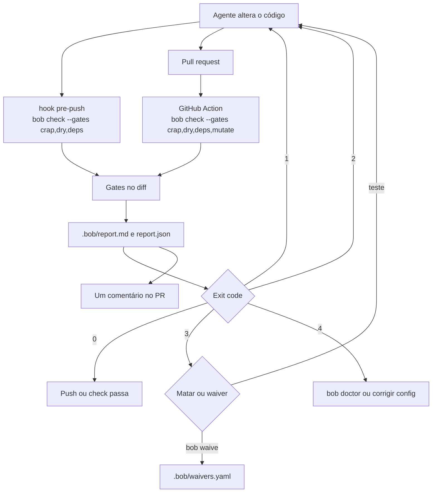

# Visão geral

[Índice](README.md) · [Instalação](instalacao.md) · [CLI](cli.md) · [Gates](gates.md) · [Relatórios](relatorios.md) · [SPEC](SPEC.md)

O bob mede o diff que um agente de código acabou de produzir. Os gates são determinísticos: CRAP, duplicação (DRY), mutação e dependências. Cada execução devolve um exit code e grava um relatório de uma página em `.bob/`, para o agente iterar e para a pessoa que revisa saber onde olhar primeiro.

Os agentes previstos na [SPEC](SPEC.md) são Cursor, Claude Code, GitHub Copilot e Devin. As skills `bob-check`, `harden` e `review-report` dizem quando rodar a CLI, como tratar um mutante sobrevivente e como levar o relatório ao pull request. O índice para agentes no repositório é [AGENTS.md](../AGENTS.md).

A fórmula, os limiares, o escopo no diff, a mutação diferencial e os waivers ficam no núcleo Python (`src/bob_quality/`). lizard, coverage.py, c8, vitest, mutmut, jscpd, import-linter e dependency-cruiser entram como dependências com versão fixada. Cada uma tem um adaptador. O bob não copia o código delas.

## O que a `main` já faz

Confirmado no [README.pt-BR.md](../README.pt-BR.md) e no código:

- CRAP em Python e TypeScript.
- Duplicação com jscpd, só como aviso.
- Dependências, com a regra que proíbe ciclos.
- Mutação diferencial em Python com mutmut, e `bob waive`.
- `bob doctor` e o pacote `bob-quality` `0.1.0`, com sdist e wheel gerados no CI. O workflow `.github/workflows/package.yml` termina em `twine check` e `bob doctor` e não publica.
- Manifestos em `.claude-plugin/` e `.cursor-plugin/`, e o instalador `src/bob_quality/install_skills.py`.
- GitHub Action em `.github/actions/bob`, usada por `.github/workflows/bob.yml`, que comenta o relatório no pull request.

O [README.pt-BR.md](../README.pt-BR.md) ainda lista como planejado:

- Mutação em TypeScript com StrykerJS ([#8](https://github.com/fazedordecodigo/bob/issues/8)). Não há referência a Stryker em `src/bob_quality/`.
- O comando `bob report`. O parser em `src/bob_quality/cli.py` não o registra.
- Publicação no PyPI e nos marketplaces.

O mesmo README lista um aviso de mutantes `no_coverage` como planejado ([#31](https://github.com/fazedordecodigo/bob/issues/31)). O código já grava esse aviso e não muda o exit code por causa dele. A fase 2 da decisão 11 da [SPEC](SPEC.md) (esses mutantes nas funções do diff falhando com exit `3`) não está no `_finish` de `src/bob_quality/mutate.py`. Detalhe em [Mutação](gates.md#mutação).

## Fluxo

O agente altera o código. Na máquina de quem desenvolve, o hook `src/bob_quality/hooks/pre-push` roda `bob check --gates crap,dry,deps`. No pull request, a Action roda `bob check` com `crap,dry,deps,mutate`. Os dois medem as funções do diff (`git diff <base>...HEAD`), gravam `.bob/report.md` e `.bob/report.json` e saem com o mesmo conjunto de códigos.

Os códigos estão em [Exit codes](exit-codes.md). O conteúdo do relatório está em [Relatórios](relatorios.md).

## Escopo

Uma função entra no que pode bloquear quando o diff toca uma linha dela (`src/bob_quality/diff.py`, usado pelos gates). Dívida antiga aparece nas seções informativas do relatório, com o texto `fora do diff; não bloqueia` em `pt-BR`, e não muda o exit code. `--base` substitui a chave `base` do `bob.yaml`.

Linguagens do MVP, na spec e no código: Python e TypeScript/JavaScript. Um repositório misto sem Node continua medindo Python; TypeScript sai como pulado, com aviso. O caso só TypeScript sem Node sai com `4`. Ver [Gates](gates.md#monorepo-e-node-ausente).

## Créditos

Os gates seguem o fluxo do Uncle Bob. Os READMEs e as saídas do [crapper](https://github.com/unclebob/crapper) e do [mutator](https://github.com/unclebob/mutator) (0BSD) são referência de comportamento; o bob não reusa o código. Os exit codes se inspiram no mutator. O limite CRAP &lt; 10 para agentes vem do [post no X](https://x.com/unclebobmartin/status/2108946115169030596). Matar mutantes dentro do razoável vem do [podcast da Aviator](https://www.aviator.co/podcast/uncle-bob-martin-ai-clean-code). Um dryer estrutural próprio, na linha do [dryer](https://github.com/unclebob/dryer), está fora do MVP na [SPEC](SPEC.md).
